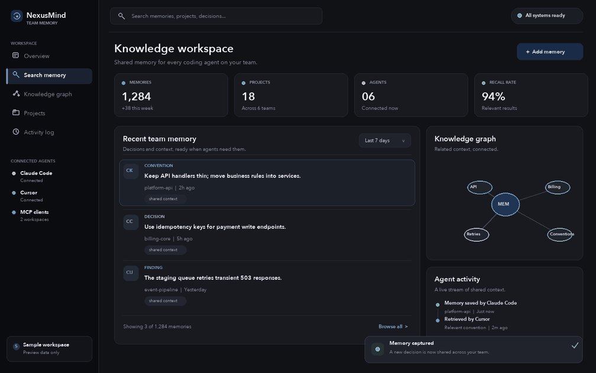
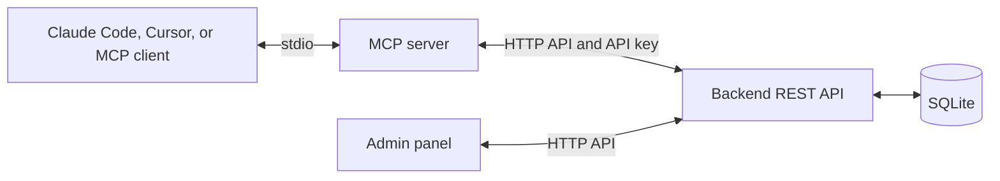

# NexusMind

<p align="center">
  <strong>Persistent, shared memory for AI coding agents.</strong><br />
  Give Claude Code, Cursor, and other MCP clients one searchable, auditable context layer for your team.
</p>

<p align="center">
  <a href="#quick-start">Quick start</a> ·
  <a href="#how-it-works">How it works</a> ·
  <a href="docs/RUNNING.md">Documentation</a> ·
  <a href="https://github.com/smart-coder-labs/nexusmind-mcp">MCP server</a>
</p>

<p align="center">
  <a href="https://github.com/smart-coder-labs/nexus-mind/actions/workflows/ci.yml"></a>
  <a href="LICENSE"></a>
  
</p>

<p align="center">
  <a href=".github/assets/nexusmind-preview.png"></a>
</p>

<p align="center"><sub>From saved decision to reusable project context — preview uses fictional sample data.</sub></p>

<details open>
<summary><strong>Explore NexusMind</strong></summary>

- [Why shared memory](#why-shared-memory)
- [What you can do](#what-you-can-do)
- [Quick start](#quick-start)
- [Connect an AI coding agent](#connect-an-ai-coding-agent)
- [How it works](#how-it-works)
- [Development](#development)
- [Related projects](#related-projects)

</details>

## Why shared memory

AI coding assistants are useful, but project decisions and conventions often get trapped in separate chats. NexusMind is an open-source, self-hosted memory layer for AI agents: capture team knowledge once, then search and reuse it from compatible coding tools and projects.

Use it as persistent memory for Claude Code, Cursor, and MCP-compatible clients. Keep technical decisions, conventions, findings, and project context in one place, with an admin interface and an audit trail.

## What you can do

- **Share context across agents.** Store and retrieve memories through the Model Context Protocol (MCP), so compatible assistants can work from the same team knowledge.
- **Find relevant decisions.** Search memories by project, tag, or content instead of repeating the same discovery in every conversation.
- **See how knowledge connects.** Explore related memories and projects in a knowledge graph.
- **Keep teams in control.** Manage users, roles, API keys, and audit events from the admin panel.
- **Run it yourself.** Start the backend and admin panel with Docker Compose; data is stored in SQLite by default.

## Quick start

Start a local demo with Docker Compose:

```bash
make demo
```

Open **http://localhost:3000** and sign in with the demo key printed by the command (`nm_demo_acme_admin`).

> **Heads-up:** the demo setup rebuilds and reseeds `apps/backend/data/nexusmind.db`. Run it in a disposable local checkout, not against a database with data you need to keep.

For a manual development setup, environment requirements, and the MCP inspector, see [Running NexusMind locally](docs/RUNNING.md).

## Connect an AI coding agent

Build the MCP server and set a demo member key:

```bash
make mcp-build
export NEXUSMIND_API_KEY=nm_demo_acme_sarah
```

Open Claude Code from the repository root. The included MCP configuration starts NexusMind with three tools:

| Tool | Use it to |
| --- | --- |
| `store_memory` | Save a decision, convention, finding, or project note. |
| `search_memory` | Find relevant shared context. |
| `list_memories` | Browse recent memories and filter by project. |

For example, ask your coding agent: **“Remember that all REST endpoints use snake_case, and tag it as a convention.”** Search for that decision later from another compatible agent.

## How it works



The MCP server connects coding agents to the backend. The admin panel uses the same API to manage team access, browse knowledge, and review activity.

## Technology

| Component | Technology |
| --- | --- |
| Backend API | Rust, Axum, SQLite |
| Admin panel | React, TypeScript, Vite |
| Agent integration | TypeScript, Model Context Protocol |
| Local deployment | Docker Compose |

## Development

```bash
# Backend
make backend

# Admin panel (in another terminal)
cd apps/admin && npm install && npm run dev

# MCP server
make mcp-build

# MCP smoke test (backend must be running)
NEXUSMIND_API_KEY=nm_demo_acme_sarah make mcp-test
```

See [docs/RUNNING.md](docs/RUNNING.md) for prerequisites, ports, demo setup, and additional workflows.

## Related projects

- [nexusmind-mcp](https://github.com/smart-coder-labs/nexusmind-mcp) — standalone MCP server package for connecting coding agents to NexusMind.
- [nexusmind-claude-plugin](https://github.com/smart-coder-labs/nexusmind-claude-plugin) — Claude Code plugin with the MCP server, hooks, and skills.

## License

[MIT](LICENSE)
