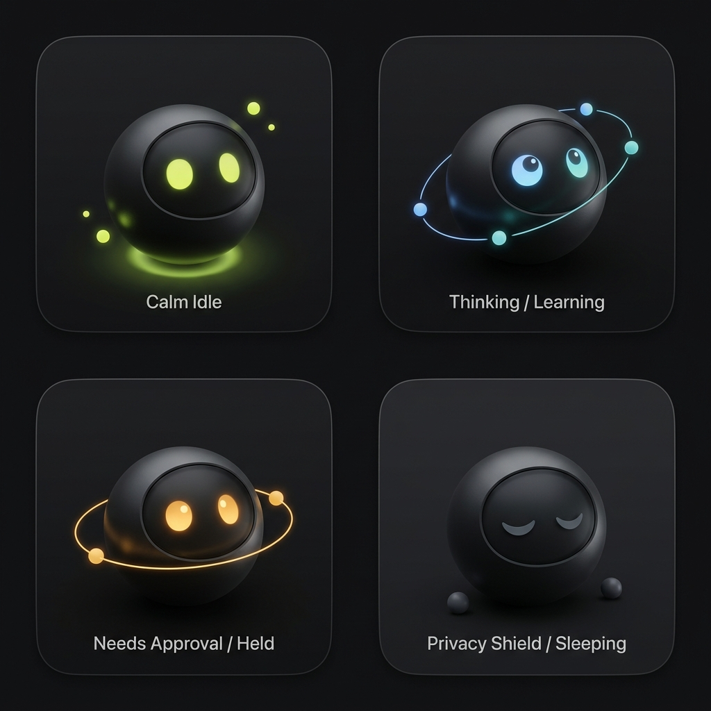

# NexusMind Desktop Mascot (macOS First)

Compañero autónomo de escritorio para NexusMind: **Orbe Sináptico** minimalista (estética *Audit1 Lime*), con motor de decisiones dual **Laya (local)** ↔ **Jev (cloud)** vía `/v1/systemone`, aprendizaje continuo local-first sincronizado con NexusMind y control total del PC.



## Arquitectura del Monorepo

| Componente | Ruta | Rol |
|---|---|---|
| **System 1 Client** | `crates/systemone-client` | Cliente Rust unificado para `/v1/systemone` (`laya_local`, `jev_cloud`, `hybrid`, `deterministic_only`) |
| **Core Daemon** | `apps/mascot-daemon` | Motor Rust portable (macOS/Linux/Windows): Policy Engine con Pisos Deterministas, Redactor local, SQLite episódico/skills, System 2 (Claude/Gemini/OpenAI), NexusMind Sync e IPC `mascot-ipc-v1` |
| **macOS Native App** | `apps/mascot-macos` | App SwiftUI + AppKit: Orbe Sináptico animado, `NSPanel` flotante, Menu Bar con *Outcome Tape*, Approval Pill (*Held means held*) y puentes nativos (`NSWorkspace`, `AXUIElement`, `ScreenCaptureKit`, `CGEvent`) |
| **Benchmark Spike** | `scripts/mascot/laya_vs_jev_spike.py` | Suite de 20 casos reales de escritorio para comparar latencia y precisión entre Laya local y Jev Cloud |

## Inicio Rápido en macOS (Apple Silicon)

### Opción rápida (1 comando)
```bash
./scripts/mascot/setup_macos.sh --with-laya-mlx --install-launchd
```

### Paso a paso manual
### 1. Arrancar Laya local (opcional si usas Jev Cloud o modo Híbrido)
```bash
pip install laya-mlx
# Exponer el endpoint compatible /v1/systemone en el puerto 8787
laya-serve --port 8787
```

### 2. Inicializar configuración y arrancar el Daemon en Rust
```bash
cd apps/mascot-daemon
cargo run -- init-config
# Edita ~/.nexusmind/mascot.yaml para elegir Laya / Jev / Hybrid y tu LLM (Claude/Gemini/OpenAI)
export ANTHROPIC_API_KEY="..."      # o GEMINI_API_KEY / OPENAI_API_KEY
export TYPESAFE_API_KEY="..."       # opcional, para Jev Cloud o escalado en modo Hybrid
export NEXUSMIND_API_KEY="..."      # opcional, para sincronizar memoria multi-PC

cargo run -- check-decision-engine
cargo run -- run
```

### 3. Abrir y compilar la App nativa macOS (SwiftUI)
```bash
cd apps/mascot-macos
swift run
# O abre apps/mascot-macos/Package.swift directamente en Xcode
```

### 4. Correr el Spike Laya vs Jev
```bash
python3 scripts/mascot/laya_vs_jev_spike.py --target laya
TYPESAFE_API_KEY=... python3 scripts/mascot/laya_vs_jev_spike.py --target both
```
